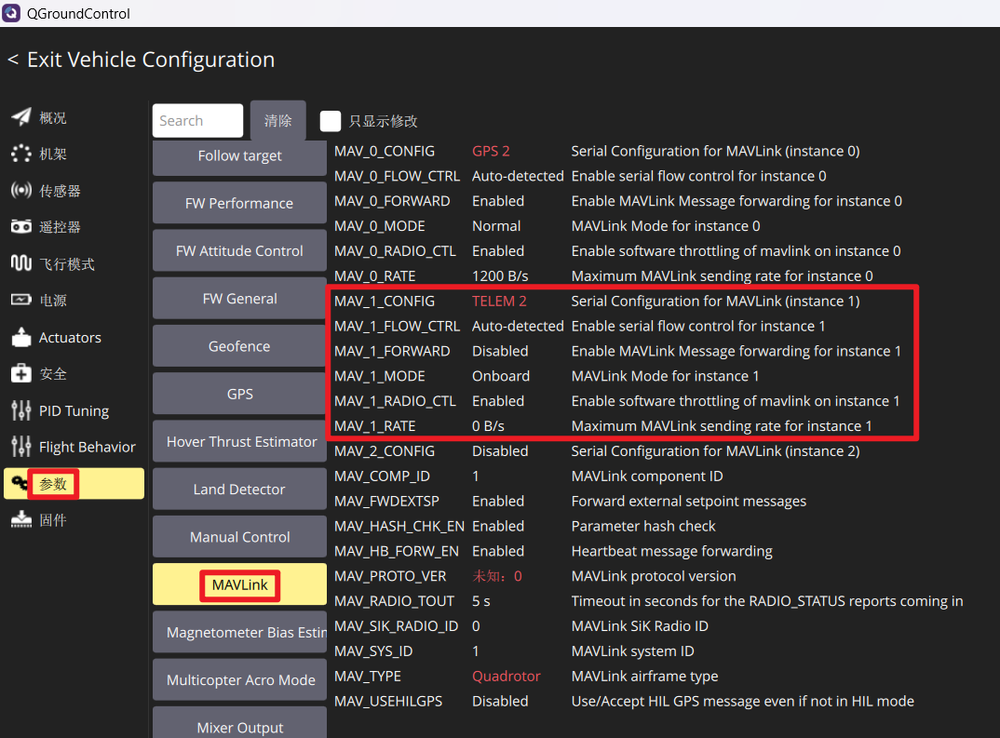
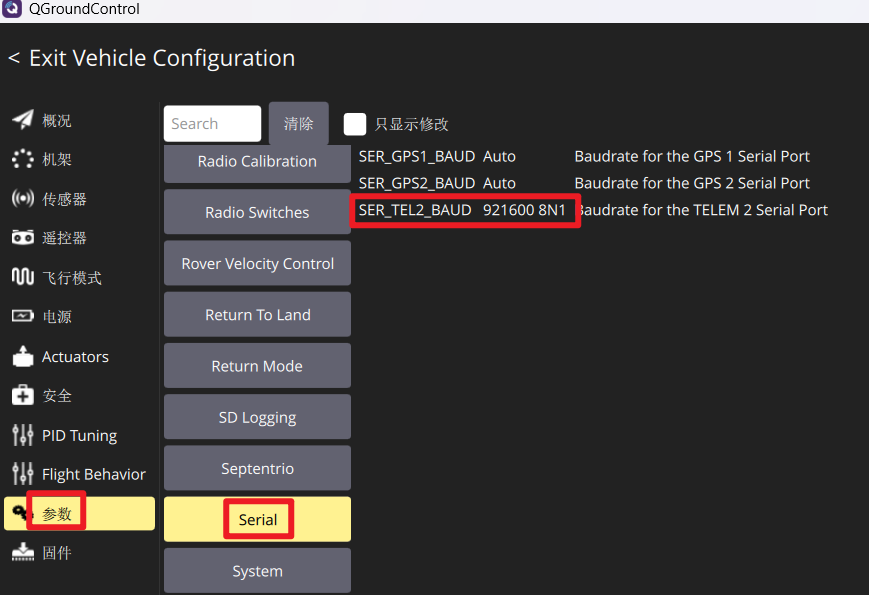
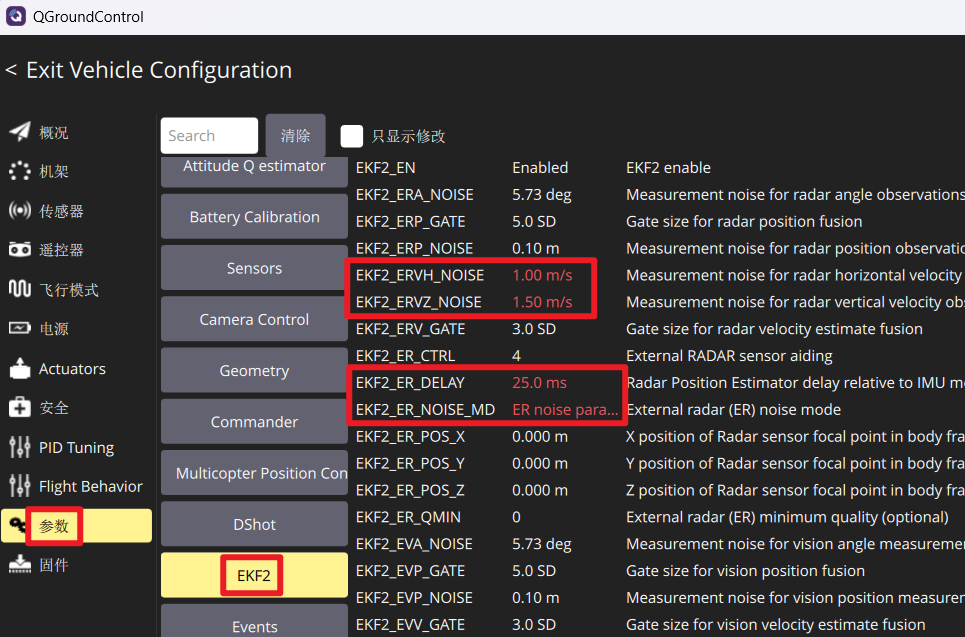
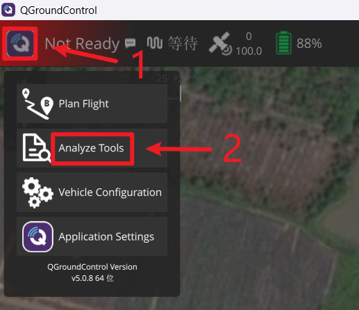
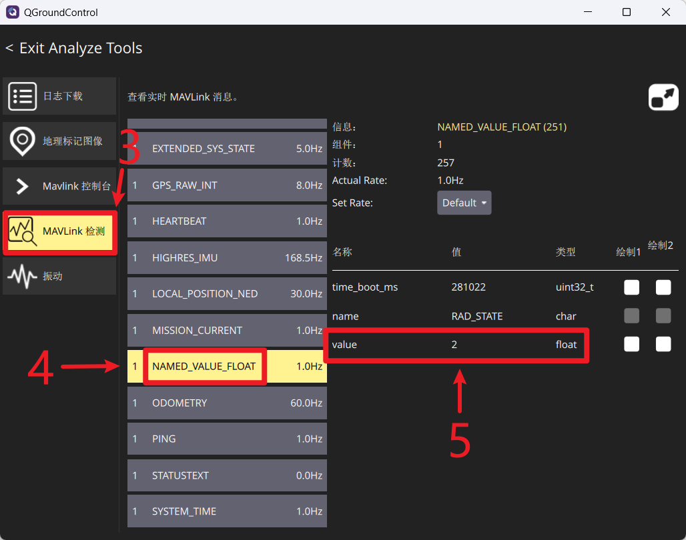

## PX4集成雷达模块使用教程
## 1 项目简介
本项目基于**PX4 v1.15.4**二次开发，用于集成雷达模块，可以实现无GNSS情况下的雷达定位功能。

## 2 飞控固件
在本仓库的**Releases页面**显示有目前已经自动编译生成的飞控固件，用户可以根据自己的飞控硬件型号，下载对应的飞控固件。以Holybro Pixhawk 6X为例，Releases页面对应的飞控型号为px4_fmu-v6x_default.px4。用户如需自己编译飞控固件，下载本仓库**release分支**的代码编译即可。

## 3 连接雷达
### 3.1 接线说明
飞控通过数传接口以MAVLink协议和雷达模块通信。以Holybro Pixhawk 6X飞控为例，选择飞控的**TELEM2**接口连接雷达模块，TELEM2接口对应的飞控串口为UART5。连接雷达模块时，需要连接以下三根线：
* 飞控的RX5连接雷达的TX1；
* 飞控的TX5连接雷达的RX1；
* 飞控的GND连接雷达的GND。

### 3.2 参数配置
如下图所示，配置飞控数传接口参数，选择一个未使用的MAVLink实例，以MAV_1为例，需要配置以下参数：
* MAV_1_CONFIG=TELEM2；
* MAV_1_MODE=Onboard；
* SER_TEL2_BAUD=921600 8N1。

如下图所示，配置雷达导航融合参数，需要配置以下参数：
* EKF2_ERVH_NOISE=1.00m/s；
* EKF2_ERVZ_NOISE=1.50m/s;
* EKF2_ER_DELAY=25.0ms
* EKF2_ER_NOISE_MD= ER noise parameters.

### 3.3 检查飞控是否接收到雷达数据
在QGC地面站中，按下图所示步骤，依次点击“Q图标”、“Analyze Tools”、“MAVLink检测”，“NAMED_VALUE_FLOAT”，找到图中数字5指向的数值Value：
* **显示为2：表示飞控可以接收到雷达数据，且雷达数据有效**；
* 显示为1：表示飞控可以接收到雷达数据，但雷达数据无效；
* 显示为0：表示飞控没有接收到雷达数据。

  
 

## 4 配置GPS/雷达切换开关
### 4.1 设置遥控器通道
飞控接入雷达和GPS之后，需要设置一个三段拨杆的遥控通道，用于选择采用视觉、雷达、GPS进行定位。
参数POS_FUSION_RC表示用于切换雷达和GPS的遥控通道，用户如需采用遥控通道6，则将参数“POS_FUSION_RC”修改为6即可。

### 4.2 验证GPS/雷达切换功能
拨动拨杆开关，并检查相应的参数是否正确，以此验证GPS/雷达切换功能是否正确。
* 当拨杆位于**高位**时，表示采用**雷达定位**，参数“EKF2_ER_CTRL=4”和“EKF2_GPS_CTRL=0”即表示采用雷达定位功能;
* 当拨杆位于**中间**时，表示采用**GPS定位**，参数“EKF2_ER_CTRL=0”和“EKF2_GPS_CTRL=7”即表示采用GPS定位功能;
* 当拨杆位于**低位**时，表示采用**视觉定位**，参数“EKF2_EV_CTRL=4”即表示采用视觉定位功能。**当前没有加装视觉模块，视觉定位功能不可用。**

## 5 其它
### 5.1 推荐参数配置
* EKF2_TERR_MASK: 不勾选 use range finder
* EKF2_RNG_CTRL: Disable range fusion
* MPC_ALT_MODE: Altitude following

